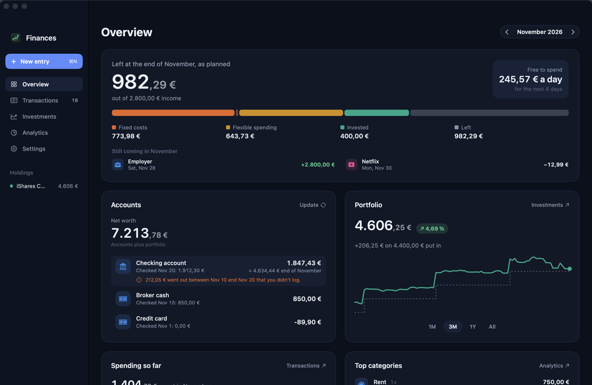
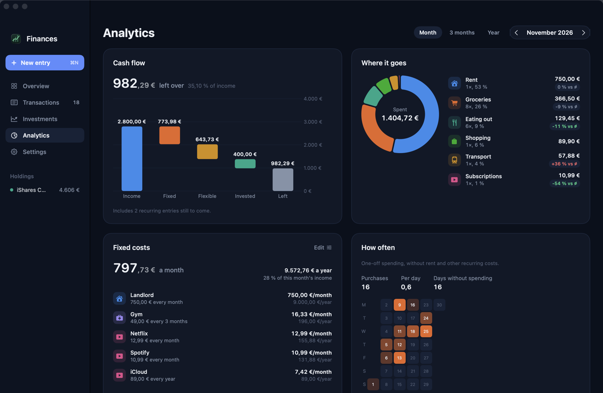
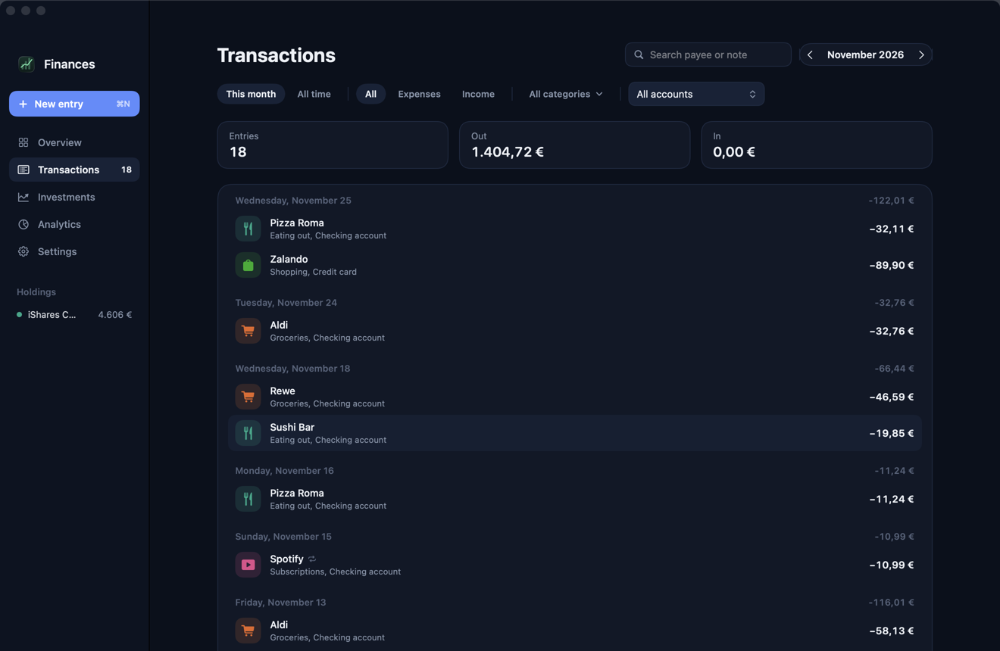
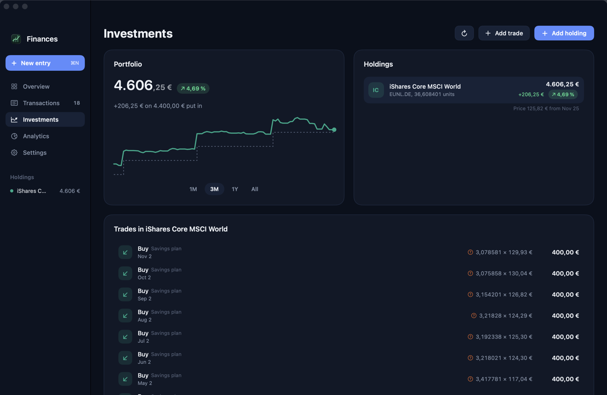
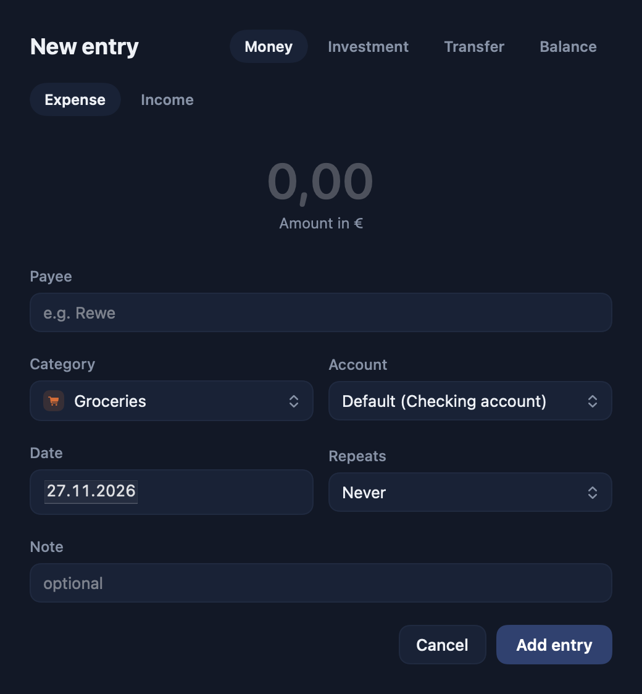

# Finances

A private money tracker for macOS. You enter your income and spending by hand, and Finances shows where your money goes, how much will be left at the end of the month, and what your investments are worth.

Everything stays on your Mac. The data file is encrypted and the app opens with Touch ID or your Mac password.



## Features

- **Month-end forecast.** Shows what will be left at the end of the month, counting recurring income and bills that haven't happened yet, and how much you can spend per day.
- **Quick entry.** Press ⌘N to add an expense, income, trade, transfer or account balance. Set "Repeats" to make any of them recurring (weekly, monthly, every 3 months, yearly).
- **Categories and payees.** Shows how much you spend per category and how often. Payees you've used before fill in their category.
- **Analytics.** Cash flow waterfall, spending by category against your average, fixed costs per month and year, a calendar heatmap of spending, savings rate over time.
- **Accounts.** Enter your balance from your banking app now and then. Finances shows each account's balance now and at month end, your net worth, and spending you didn't log.
- **Transfers.** Move money between accounts once or on a schedule. Transfers don't count as income or spending.
- **Investments.** Track ETFs and stocks with live prices from Yahoo Finance. Savings plans are added automatically each month, and units are worked out from that day's closing price.
- **Encrypted and locked.** The data file is AES-GCM encrypted with a key in your keychain. The app locks when your Mac sleeps or the screen locks.

| Analytics | Transactions |
|---|---|
|  |  |

| Investments | Quick entry |
|---|---|
|  |  |

## Install

1. Download `Finances.zip` from the [latest release](https://github.com/TheKerbecs/finances/releases/latest).
2. Unzip it and move `Finances.app` to your Applications folder.
3. The app isn't notarized, so macOS blocks the first launch. Open System Settings → Privacy & Security and click "Open Anyway", or run:

   ```sh
   xattr -dr com.apple.quarantine /Applications/Finances.app
   ```

Requires macOS 15 or later.

## Getting started

1. Open Finances and unlock it with Touch ID or your Mac password.
2. In Settings → Recurring, add your salary, rent and subscriptions.
3. Press ⌘N → Balance and enter your bank balance.
4. Add your ETFs under Investments → Add holding. Search by name or ISIN and pick a listing marked EUR.
5. Log spending with ⌘N as it happens.

## Your data

Everything is in `~/Library/Application Support/Finances/`:

- `data.json`: all your entries, encrypted.
- `data.prev.json`: an encrypted copy from the last unlock.
- `prices/`: cached daily prices. Safe to delete.

The encryption key is in your login keychain as "Finances data key". Go to Settings → Security → Show recovery key and save it in a password manager. Without the keychain entry or the recovery key, your data can't be opened. To move to a new Mac, copy the folder and enter the recovery key when asked.

The only network requests go to Yahoo Finance, for prices and ticker search.

## Build from source

You need the Xcode command-line tools (`xcode-select --install`). Xcode itself isn't needed.

```sh
./build.sh
```

This runs the checks, builds a release binary, wraps it into `Finances.app`, signs it ad hoc, and copies it to `~/Applications`.

The app is signed ad hoc, so after each rebuild macOS asks for your Mac password once before the new build can read the keychain key. Choose "Always Allow".

## Development

Run the logic checks:

```sh
swift run SelfCheck          # offline
swift run SelfCheck --live   # also fetches real prices from Yahoo
```

Run the app against a test folder instead of your real data:

```sh
FINANCES_DATA_DIR=/tmp/finances-test FINANCES_NO_LOCK=1 .build/debug/Finances
```

With `FINANCES_DATA_DIR` set, the key is a `test.key` file in that folder instead of the keychain. `FINANCES_NO_LOCK=1` skips the lock screen and only works together with `FINANCES_DATA_DIR`.

`FINANCES_SNAPSHOT=/tmp/shot.png` renders the window to a PNG and quits. `FINANCES_SNAPSHOT_SECTION` picks the screen (`overview`, `transactions`, `investments`, `analytics`, `settings`, `quickadd`, `trade`, `transfer`, `addholding`).

The code is split into:

- `Sources/FinanceCore`: models, storage, encryption, forecasts, analytics, prices. No UI.
- `Sources/Finances`: the SwiftUI app.
- `Sources/SelfCheck`: checks for the core logic.

Two workarounds for building without Xcode:

- In the macOS 27 SDK, `@State` is a macro whose plugin ships only with Xcode. Views use `@Local`, a typealias for `SwiftUI.State`.
- SwiftUI has its own `Transaction` type, so the app code calls the model type `Tx`.

## License

[MIT](LICENSE)
